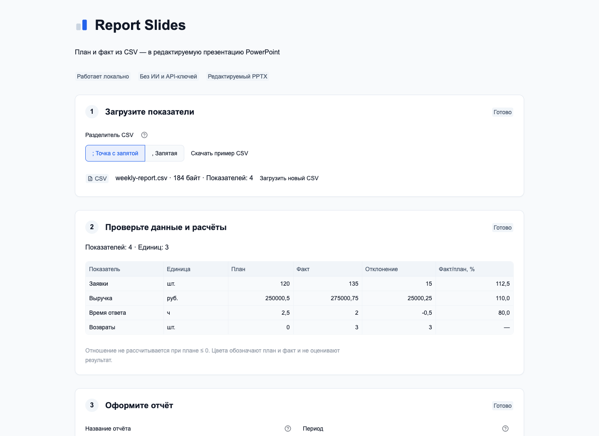
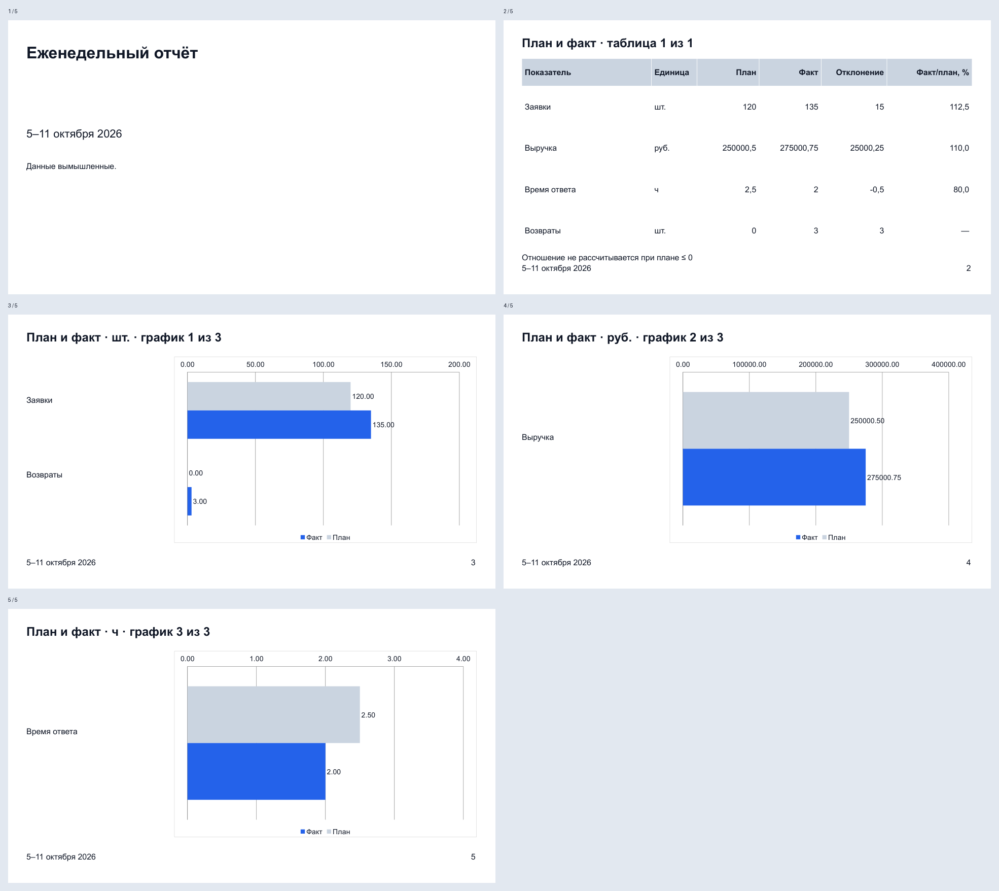

# Report Slides

[](https://www.python.org/downloads/) [](#быстрый-запуск) [](samples/weekly-report.csv) [](https://github.com/balyakin/report-slides/actions/workflows/tests.yml)



Цифры за неделю собраны. Осталось обновить слайды.

**Report Slides** превращает CSV с планом и фактом в редактируемую презентацию PowerPoint. Вы загружаете таблицу, проверяете прочитанные значения, добавляете период и комментарий — затем скачиваете PPTX. На следующей неделе достаточно заменить данные: расположение таблиц, цвета и шрифты повторятся.

Приложение работает локально, в браузере. Модель и API-ключ не нужны. Числа разбираются и считаются через Decimal, а текст, таблицы и диаграммы остаются обычными объектами PowerPoint, которые можно поправить после скачивания.

На скриншоте — вымышленный отчёт из [образца CSV](samples/weekly-report.csv). Он даёт пять слайдов: титул, таблицу и три графика, отдельно для штук, рублей и часов.

## Быстрый запуск

Нужен **Python 3.11 или новее**. Установите его с [python.org](https://www.python.org/downloads/), скачайте репозиторий и откройте терминал в каталоге `report-slides`, рядом с `app.py`.

**Windows PowerShell**

```powershell
py -3 --version
py -3 -m venv .venv
.\.venv\Scripts\python.exe -m pip install -r requirements.txt
.\.venv\Scripts\python.exe -m streamlit run app.py --server.address 127.0.0.1 --server.port 8504 --browser.gatherUsageStats false
```

**macOS и Linux**

```bash
python3 --version
python3 -m venv .venv
.venv/bin/python -m pip install -r requirements.txt
.venv/bin/python -m streamlit run app.py --server.address 127.0.0.1 --server.port 8504 --browser.gatherUsageStats false
```

Откройте **http://127.0.0.1:8504**. Готово.

Активировать окружение не обязательно: команды уже обращаются к Python из `.venv`. Если на Linux отсутствует модуль `venv`, установите системный пакет `python3-venv`. Занятый порт 8504 обычно означает, что приложение уже запущено в другом терминале; остановите тот экземпляр через `Ctrl+C`.

Интернет нужен для установки зависимостей. Загрузка CSV, просмотр, генерация и скачивание отчёта обходятся без внешних запросов. Сервер слушает только `127.0.0.1`.

## Первый отчёт — на образце

1. Нажмите «Скачать пример CSV» и загрузите полученный файл. Разделитель оставьте `;`.
2. Сверьте таблицу: план, факт, единицы, отклонение и отношение факта к плану.
3. Укажите период, например «5–11 октября 2026». При желании поменяйте название и добавьте комментарий.
4. Посмотрите состав презентации. Нажмите «Создать презентацию», затем «Скачать PPTX».

В `report-slides.pptx` будет пять слайдов. Их можно открыть и редактировать.



Текст меняется в текстовых блоках, значения таблицы — прямо в ячейках. Для чисел диаграммы выберите «Изменить данные»: откроется встроенная книга. Длинные названия показателей вынесены в текстовые подписи слева от графика; если переименовали показатель в книге, поправьте и его подпись на слайде.

## Своя таблица из Excel

На активном листе нужны четыре колонки. Именно в таком порядке:

```csv
показатель;план;факт;единица
Заявки;120;135;шт.
Выручка;250000,50;275000,75;руб.
Время ответа;2,5;2;ч
Возвраты;0;3;шт.
```

В Excel выберите «Сохранить как» → **CSV UTF-8**. Обычный CSV в системной кодировке не подойдёт. Экспортируется только активный лист; исходную книгу XLSX сохраните отдельно.

Разделитель стоит проверить. Даже если название формата в Excel упоминает запятые, в файле могут оказаться точки с запятой: откройте первую строку CSV в текстовом редакторе и выберите `;` или `,` в приложении. Менять региональные настройки компьютера не нужно.

При разделителе `,` десятичная запятая требует кавычек: `Заявки,"120,5",135,шт.`. Кавычки внутри названия удваиваются: `"Заявки ""новые""";120;135;шт.`. При сохранении Excel обычно делает это сам.

| Что | Допустимый ввод |
|---|---|
| Файл | `.csv`, UTF-8 с BOM или без, до **256 КиБ — 262 144 байт** |
| Показатели | От **1 до 12**, названия уникальны без учёта регистра |
| Название показателя / единица | До 60 / 16 символов; без табуляции и переводов строк |
| План и факт | От −1 000 000 000 до 1 000 000 000 включительно; максимум два дробных знака |
| Название отчёта / период | Обязательные, одна строка, до 100 / 60 символов |
| Комментарий | До 400 символов и 6 непустых абзацев; пустые строки не занимают место на титуле |

У чисел допустимы знак `+` или `-`, точка и десятичная запятая. Пробелы внутри числа, знаки валют, проценты, экспонента и NaN отклоняются. Если Excel экспортировал `250 000,50`, отключите разделитель групп разрядов в числовом формате ячеек и сохраните CSV заново. Для единицы `%` запишите `25` вместо `25%`. Ошибка в одной строке останавливает весь импорт — строка не исчезнет, а её значение не превратится в ноль. Приложение подскажет поле и номер строки.

Формулы, URL, HTML и Markdown в пользовательском тексте остаются текстом.

## Как считаются числа и собираются слайды

Отклонение — **факт минус план**. При положительном плане отношение равно `факт / план × 100`; округление до одного дробного знака идёт по правилу HALF_UP. Например, `1 / 16` даст `6,3`. При плане ≤ 0 в этой колонке стоит `—`.

С единицей `%` сохраняется исходная шкала: число `25` означает 25. Разные показатели не суммируются, общего процента выполнения нет. Рост возвратов и сокращение времени ответа имеют разный смысл, поэтому цвет обозначает серию «План» или «Факт», а не оценку результата.

Оформление одно: светлый шаблон 16:9, Arial. Сначала титул, затем таблицы по четыре показателя, после них — графики по единицам, тоже максимум по четыре показателя. Порядок исходных строк сохраняется. `руб.`, `₽` и `рублей` — три разные группы; регистр у одинаковых единиц не учитывается.

## Следующая неделя

Нажмите **«Загрузить новый CSV»**. Старые данные и PPTX сразу станут недоступны, загрузчик очистится. Теперь выбирайте новый файл и заполните период; название отчёта сохранится, комментарий — очистится. Явный сброс защищает и от случая, когда браузер отклоняет слишком большой файл ещё до его чтения приложением.

Чтобы длины полос можно было сравнивать между неделями, откройте **«Шкалы графиков»**, включите
«Фиксированная шкала» для нужной единицы и введите минимум и максимум, например `0` и `200` для `шт.`.
Границы общие для плана, факта и всех страниц этой единицы; ноль должен входить в диапазон.
Допустимы точка или запятая, до двух дробных знаков и значения в пределах ±1 000 000 000.
Приложение проверит деления и при необходимости предложит подходящие границы. Само оно их не меняет.

Нажмите **«Сохранить шкалы в адресе»** и добавьте обновлённую страницу в закладки. На следующей неделе
откройте эту закладку, загрузите новый CSV и заполните период: шкалы восстановятся из ссылки.
В ссылку входят только единицы и границы, без CSV, названия, периода и комментария.
Изменения полей не обновляют ссылку автоматически. В одной сессии настройки сохраняются при замене CSV,
в том числе для временно отсутствующих единиц. «Сбросить шкалы» возвращает автоматический режим,
сохраняя текущий CSV и поля отчёта. Для ссылки действуют ограничения: 32 фиксированные единицы,
4096 байт JSON и 8192 байт закодированного параметра.

Если план или факт выходит за границу, появятся все предупреждения и предложение диапазона.
Экспорт блокируется, прежний PPTX убирается: столбец за пределами оси PowerPoint обрежет.
Измените границы или выключите фиксацию. На каждом фиксированном графике подписаны его границы.
Без фиксации остаётся прежний автоматический подбор отдельно для каждой страницы графиков.

Ручные правки PowerPoint в следующий экспорт не переносятся. Новая презентация собирается из новой таблицы и полей приложения, по встроенному шаблону. Смена только разделителя сохраняет период и комментарий, но убирает прежний PPTX до нового создания. Изменение названия, периода или комментария тоже убирает прежний PPTX; при неудачном повторе с неизменёнными входами прежний успешный файл остаётся доступен.

**Скачайте результат вовремя.** Сохранение рабочей сессии после обновления страницы, закрытия вкладки или перезапуска не обещано. Приложение не меняет исходный CSV, не записывает пользовательские файлы на диск и не ведёт историю. Место сохранения скачанного PPTX выбирает браузер.

Первый релиз рассчитан на одного пользователя и одну активную вкладку. Импорт XLSX, PDF и готового PPTX, свободный редактор макетов, изображения, анимации и ИИ-выводы сюда не входят.

## Проверки

Из каталога проекта, без запуска веб-сервера:

```powershell
# Windows
.\.venv\Scripts\python.exe -m unittest discover -s tests -v
```

```bash
# macOS / Linux
.venv/bin/python -m unittest discover -s tests -v
```

В наборе — строгий CSV, граничные числа и Unicode, расчёты Decimal, настоящие PPTX и встроенные XLSX, сохранность текста, а также переходы состояния через Streamlit AppTest. Для GitHub подготовлен [workflow проверок](.github/workflows/tests.yml) на Python 3.11–3.14.

16 октября 2026 на macOS прошли **78 тестов на Python 3.11 и 3.14**, Ruff и браузерный сценарий Chrome:
два недельных экспорта, восстановление шкал из закладки, сброс, все предупреждения и буквальный вывод URL.
В LibreOffice отрендерены и просмотрены **69 слайдов** из 15 вымышленных отчётов, включая плотную шкалу,
четыре предельно длинных названия и крайние числа. Для общего значения двух недель совпала физическая
длина полосы. Проверки воспроизводятся через `tests/browser_smoke.py` и `tests/make_previews.py`;
скриншоты интерфейса обновлены 16 октября.

**Редактирование и повторное открытие в Microsoft 365 на Windows пока не подтверждены.**
Рендеринг LibreOffice не заменяет эту проверку. Перед использованием в PowerPoint проверьте крайние
значения и длинные подписи; GitHub Actions и полный ручной проход доступности также ещё не подтверждены.

План небольшого сравнения с PPT Master и Presenton — в [eval/pilot.md](eval/pilot.md). Измерений с пользователями пока нет, поэтому обещать превосходство над другими инструментами рано.

## Лицензия

[MIT](LICENSE).
